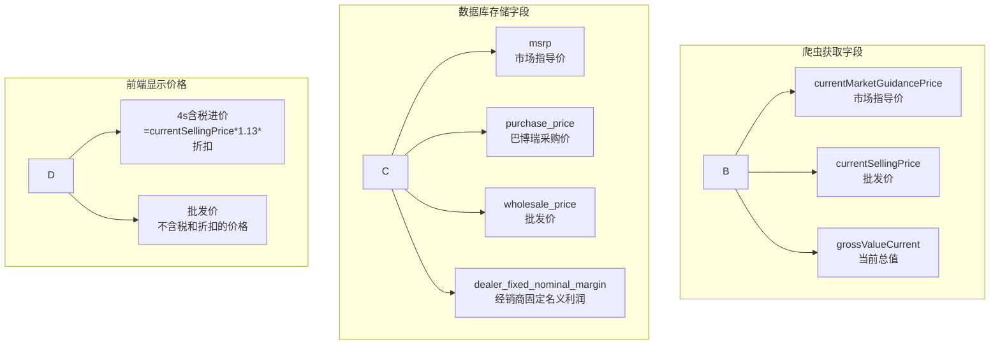
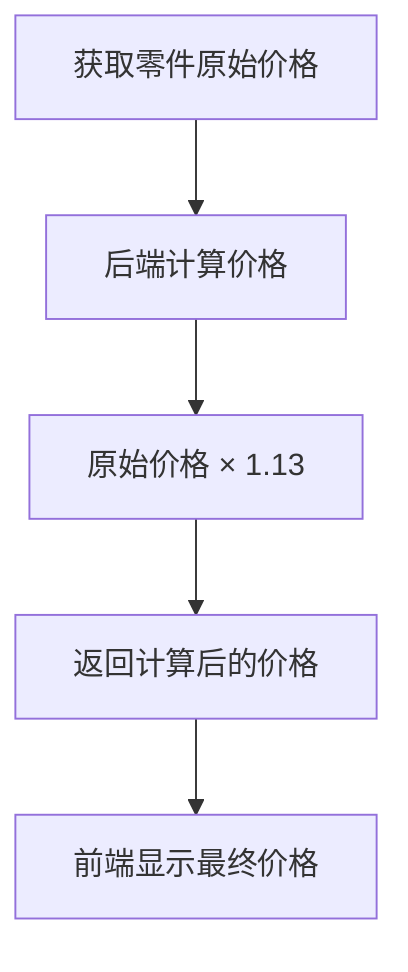
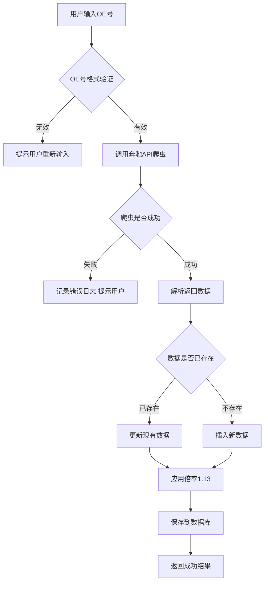

# 奔驰大库

## 待修改的功能

1. ~~中文描述取crm数据的名称，添加一个车型在crm数据取~~
2. ~~前端显示一下更新日期~~
3. ~~前端佳配采购价改成巴博瑞采购价~~
4. ~~前端加一个批发价的倍率条件设置~~

## 待添加的功能

1. 添加一个收藏功能，上传excel文件到收藏列表，并且通过爬取进行数据更新
2. ~~实现dalfsc.aftersales.mercedes-benz.com网址爬虫功能~~
3. 添加一个可以通过oe，直接爬虫新增数据的功能
4. ~~倍率改为后端1.13~~
5. ~~价格有很多，要整理一下这些价格是干什么的~~

api网址1 :
[api](https://dalfsc.aftersales.mercedes-benz.com/api/sop-china/parts-informations?partNumber=A2213308107\&customerId=193211390\&salesOrganizationId=O%2050000741)
载荷:
partNumber=A2213308107\&customerId=193211390\&salesOrganizationId=O%2050000741
请求方法: GET

api网址2:
<https://dalfsc.aftersales.mercedes-benz.com/api/sop-china/stockinformation>
载荷: \["A2213308107","A2213306707","A2213306707  80","A2213308107  80"]
请求方法: POST

### 需求5：价格整理说明

***

***

***

### 需求4：倍率改为后端1.13

***

***

***

### 需求3：通过OE号爬虫新增数据流程

