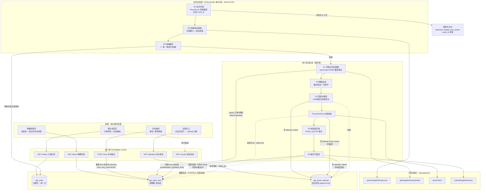
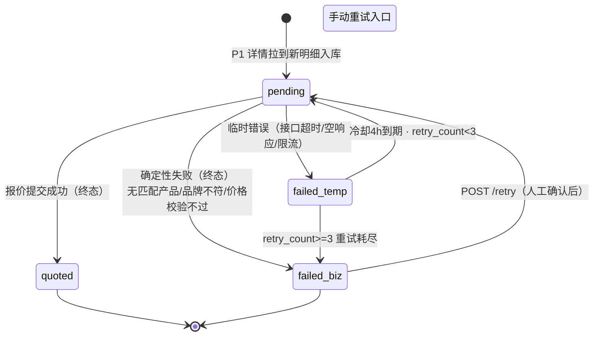

# 汽配龙自动报价重构 · 全链路设计文档

> 版本：v1.0（2026-11-18）
> 依据：新页面 HAR 抓包分析 + token 直连探测 + 假成功根因排查（详见对话记录）
> 状态：设计评审稿，流程已确认（确定性失败不重试 / MVP 不做 cannot_quote / 一单一单串行处理）

---

## 一、全链路流程图

### 1.1 顶层链路（前端 → 后端 → 汽配龙 → 数据库 → 前端）



**数据流向说明**：
- 读方向（前端）：`FE → API → qpl_order/qpl_order_item/qpl_quote_attempt`，API 只读三表，不直连汽配龙
- 写方向（任务）：`TASK → PIPE → 汽配龙接口`，每个 PIPE 节点产出立即写 attempt 流水；每单完成立即更新 order/item（**不存在批量攒内存最后一起写**）
- `round_id` 是全链路上下文标识：`{YYYYMMDDHHMMSS}_{company}`，贯穿日志与 attempt 表

### 1.2 状态机（qpl_order_item.status）



**判定规则**（已与业务确认）：
| 失败类型 | 判定 | 后续 |
|---|---|---|
| `failed_biz`（确定性） | priceCheck 校验不过 / 匹配环节无候选 / 品牌不在允许范围 | 永不自动重试 |
| `failed_temp`（临时） | 接口超时 / 响应空 / code!=10000 / HTTP 异常 / 限流 | 冷却 4h，重试 ≤3 次，耗尽转 failed_biz |
| cannot_quote | MVP 阶段不实现自动无法报价 | 仅预留状态位 |

### 1.3 异常分支与埋点位置

| 节点 | 异常场景 | 处理逻辑 | 埋点（写入位置） |
|---|---|---|---|
| R1 轮次开启 | 上一轮未结束 | 非阻塞锁直接跳过本轮，写一条轮次跳过日志 | LOG（round_skipped） |
| R1 轮次开启 | 20:00-08:00 | 完全静默 return | 无（不产生日志） |
| R2 拉单 | 列表接口失败/超时 | 本轮终止，attempt 表写 round 级失败记录 | T3(action=fetch_list, result=失败) + LOG |
| R2 拉单 | token 失效(401) | 推送企业微信预警，本轮终止 | LOG(token_invalid) + 预警推送 |
| P1 详情 | 单订单详情接口失败 | **跳过该单继续下一单**，attempt 记录 | T3 + LOG（订单级隔离） |
| P3 匹配 | 无候选产品 | item → failed_biz，fail_stage=品牌匹配 | T3(action=match, result=失败) |
| P4 校验 | priceCheck 不过 | item → failed_biz，fail_reason=校验消息 | T3(action=price_check, 存响应快照) |
| P6 提交 | 提交接口超时/空响应 | item → failed_temp（重试冷却） | T3(action=submit, request/response 快照) |
| P6 提交 | 返回 code!=10000 | 按 message 分类：临时→failed_temp，业务→failed_biz | 同上 |
| P6 提交 | 提交成功 | item → quoted，冗余价格/来源 | T3(result=成功) |
| 落库 | 单条 SQL 失败 | 捕获记日志，不影响该单其他明细 | LOG(sql_error) |

---

## 二、数据库字段存储说明

### 2.1 三层表职责

| 表 | 粒度 | 写入模式 | 作用 |
|---|---|---|---|
| `qpl_order` | 一单一行 | upsert（uk: company+supplier_enquiry_no） | 订单级信息 + 推进统计 |
| `qpl_order_item` | 一明细一行 | upsert（uk: company+enquiry_item_id） | 状态机落点 + 最新结果冗余（查询直达） |
| `qpl_quote_attempt` | 一次尝试一行 | **append-only 只插不改** | 全链路操作日志，可回放 |

### 2.2 字段 ← 链路节点映射（写入来源）

**qpl_order**（节点 R2/P1 写入）

| 字段 | 来源节点 | 说明 |
|---|---|---|
| supplier_enquiry_no / qpl_enquiry_no / tid / car_brand / car_type5 / vin_code / shop_name / trader_name / user_name / user_phone | R2 列表 + P1 详情 | 订单基础信息 |
| demand_status / accept_status / multi_quote_gray | P1 详情 | 汽配龙侧状态 |
| item_total / item_quoted | 每单完成后聚合更新 | 推进统计（前端进度条数据源） |
| enquiry_time / first_handle_time / last_handle_time | R2 / C3 | 时间戳三件套 |
| created_at / updated_at | 自动 | 记录级时间戳 |

**qpl_order_item**（节点 P1/P3/P4/P6 写入）

| 字段 | 来源节点 | 说明 |
|---|---|---|
| enquiry_item_id / item_name / item_nick_names / item_oe / item_amount / assembly_quantity / item_quality_list / sale_category_name / car_brand | P1 详情响应 | 明细基础信息（P1 首次入库） |
| status | P3/P4/P6 | **状态机**：pending/quoted/failed_biz/failed_temp |
| quote_source / matched_brand / item_sell_price / delivery_aging / parts_no / item_quality | P3-P6 | 最新报价结果冗余（查询直达，不再聚合） |
| fail_stage / fail_reason | P3/P4/P6 | 最新失败环节与原因 |
| retry_count / next_retry_time / last_attempt_time | P6 失败时 | 重试与冷却（R2/P2 过滤依据） |
| created_at / updated_at | 自动 | 记录级时间戳 |

**qpl_quote_attempt**（每个 PIPE 节点写入，append-only）

| 字段 | 说明 | 追溯价值 |
|---|---|---|
| round_id | `{YYYYMMDDHHMMSS}_{company}` | 全链路请求上下文标识，关联日志 |
| action | match / price_check / submit / fetch_list / fetch_detail | 哪一步 |
| result | 成功 / 失败 / 跳过 | 结果 |
| quote_source | CRM现货 / 奔驰接口 / 宝马接口 | 价格来源 |
| fail_stage / fail_reason | 失败环节与原因 | 排查第一入口 |
| request_snapshot (JSON) | 该步骤发出的请求体（提交体全量/priceCheck 请求） | 可精确复现当时构造 |
| response_snapshot (JSON) | 汽配龙原始响应（priceCheckSnapshot/提交回执） | 证据留存，杜绝"假成功" |
| created_at | 尝试时间戳 | 时间线 |

### 2.3 时间戳与上下文规范

- **三层时间戳**：`created_at`（记录创建）/ `updated_at`（最后变更）/ 业务时间（first_handle_time、last_attempt_time、next_retry_time）——记录级、业务级分离
- **请求上下文**：`round_id` 由 R1 生成，传入 PIPE 全部节点；每条 attempt、每条日志都携带
- **幂等保障**：order/item 双 upsert 唯一键防重；attempt 天然追加无需幂等键

### 2.4 结构化日志

- 目录：`logs/task_log/qpl_auto_quote/{YYYY-MM-DD}/`（沿用项目现有模式，无需改 logger_config）
- 行格式：`[round_id] [SIQR单号] [item_id] [节点] 消息 | 耗时=Xms`
- 与 attempt 表互补：attempt 存结论与快照（可查询），日志存过程细节（可 grep）

---

## 三、前端数据展示规范

### 3.1 页面结构（挂在现有询价模块，独立标签页）

```
汽配龙报价总览页
├── 轮次状态条：最近 round_id / 开始时间 / 状态(运行中/已完成/跳过) / 成功数、失败数
├── 订单列表（qpl_order 分页）
│   列：单号 | 车型 | 品牌 | 明细进度(item_quoted/item_total) | 单状态徽标 | 末轮处理时间
│   └── 点击行 → 明细列表
├── 明细列表（qpl_order_item 按单过滤）
│   列：OE | 品名 | 状态徽标 | 品牌 | 价格 | 来源 | 失败原因摘要 | 末次尝试时间
│   └── 点击异常行 → 尝试流水时间线（排查入口）
└── 尝试流水时间线（qpl_quote_attempt 按明细过滤，倒序）
    每个节点：时间 | action | result | 来源 | 失败原因 | [查看请求快照] [查看响应快照]
```

### 3.2 状态徽标规范

| 状态 | 徽标 | 颜色语义 |
|---|---|---|
| pending | 待处理 | 蓝（进行中） |
| quoted | 已报价 | 绿（成功） |
| failed_biz | 业务失败 | 红（终态，需人工判断） |
| failed_temp | 临时失败(冷却中) | 黄，附"下次重试 HH:mm" |

### 3.3 异常提示与排查入口

1. **失败原因直达**：明细列表失败行直接显示 fail_stage + fail_reason 摘要（超长截断，悬浮全显）
2. **一键追溯**：点击失败行打开流水时间线，定位到失败 attempt，可展开 request/response 快照 JSON（格式化展示）
3. **日志检索引导**：流水时间线头部显示对应 round_id，复制后可在日志目录 grep `round_id` 获取过程细节
4. **手动重试**：failed_biz / failed_temp 行提供「重试」按钮（POST /retry，二次确认），重置 status=pending + next_retry_time=NOW；API 层记录操作人与时间（attempt 记 action=manual_retry）
5. **轮次监控**：总览页顶部显示最近 5 轮的运行状态（含"上一轮仍在执行，本轮跳过"），解决"以为任务没跑"的观测盲区

---

## 四、问题追溯路径

| # | 问题场景 | 追溯路径 |
|---|---|---|
| 1 | 某明细为什么没报上价 | 前端：明细行 fail_reason → 点开流水时间线看失败 attempt（哪个环节、什么原因）→ 展开响应快照看汽配龙原始返回。SQL：`SELECT * FROM qpl_quote_attempt WHERE enquiry_item_id=? ORDER BY id DESC` |
| 2 | 数据库显示成功但汽配龙没生效（旧系统顽疾） | 新表下不可能：quoted 状态写入的前提是 attempt(action=submit, result=成功) 存在且带响应回执。复核路径：`item.status='quoted'` → 找最新 submit attempt → `response_snapshot` 与汽配龙详情接口实时比对 |
| 3 | 接口连续异常（限流/超时） | `SELECT round_id, action, fail_reason, COUNT(*) FROM qpl_quote_attempt WHERE created_at>?, fail_reason GROUP BY` → 定位时间段与接口 → 日志 grep round_id 看完整过程 |
| 4 | 定时任务没跑/跑了没产出 | 总览页轮次状态条 → GET /rounds 查最近轮次 → 看是"锁跳过"还是"拉单失败"→ attempt(action=fetch_list) + 日志 |
| 5 | 重试链路是否按预期冷却 | item 的 retry_count / next_retry_time + attempt 时间线：每次 failed_temp 后应看到 next_retry_time=+4h，第 4 次失败转 failed_biz |
| 6 | 手动重试做了什么 | attempt 中 action=manual_retry 的记录（含操作时间），item 状态回到 pending 的 updated_at |

---

## 五、实施阶段划分（已确认）

1. **阶段二**：三表 init（PyMySQL 侧幂等建表）+ `app/services/qpl_auto_quote/` package 骨架 + persistence 层（含单测）
2. **阶段三**：API 封装更新（PAGE 分页/quoteType/quoteExtraInfoVo 空对象策略）+ pipeline（匹配逻辑平移，拆分为 <80 行函数）+ 每文件 <400 行
3. **阶段四**：前端标签页 + API 层；旧任务冻结后下线，旧表只读保留
4. 提交规范：refactor 单独 commit；核心匹配/状态机逻辑必须单测
